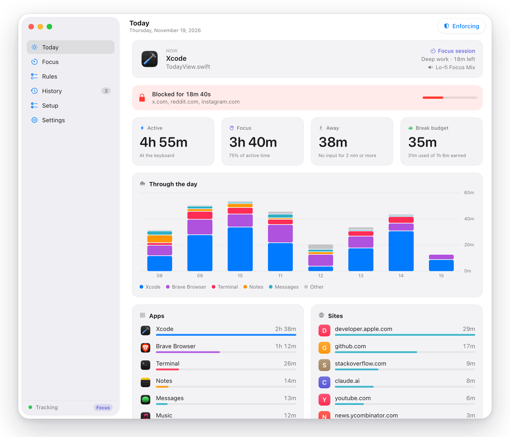
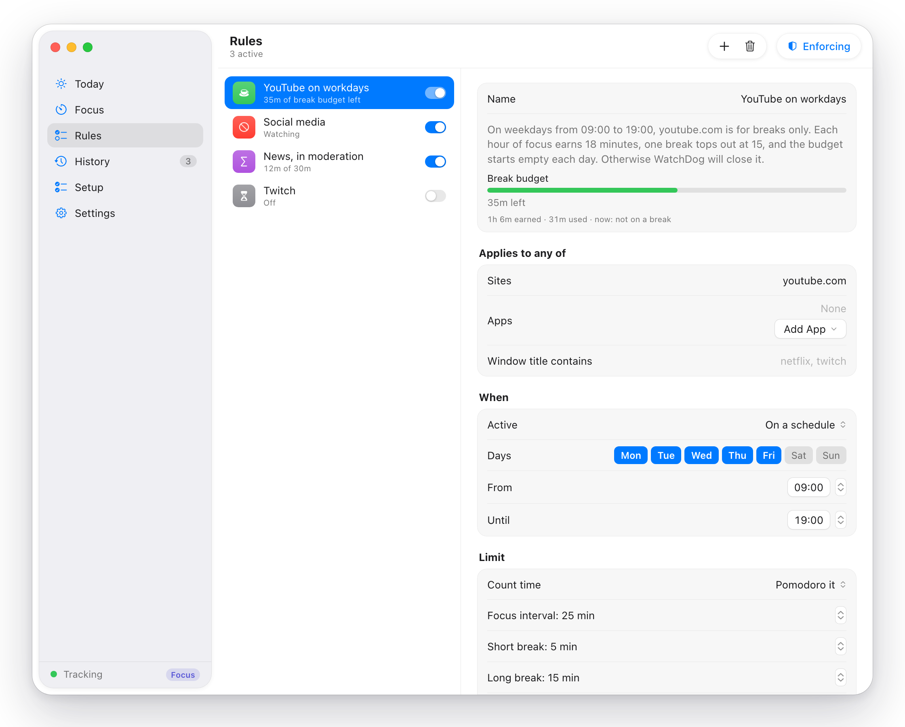
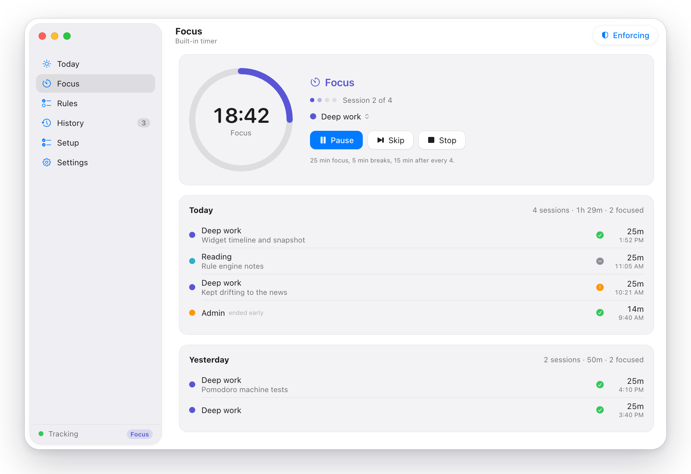
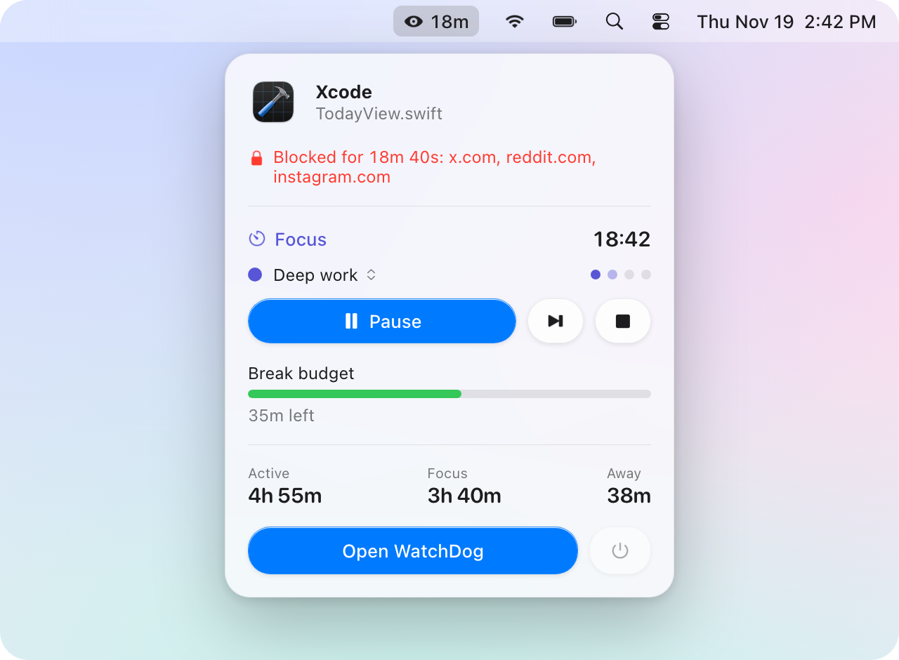
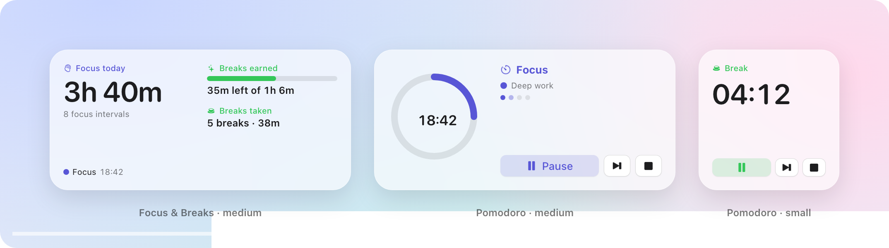
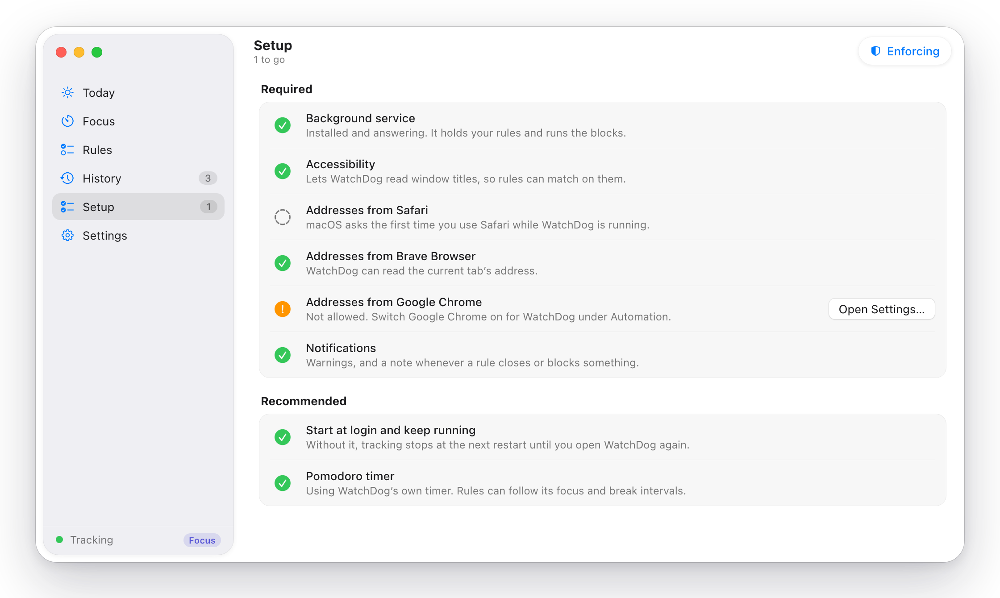
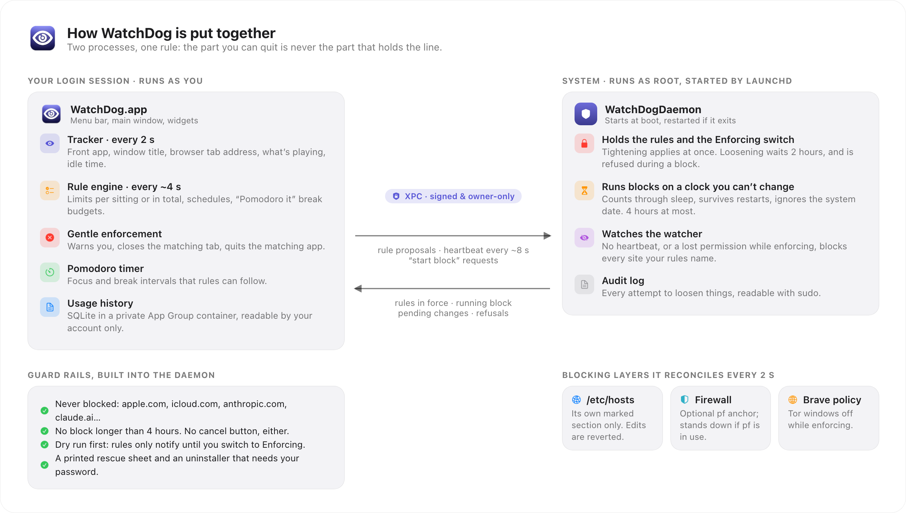
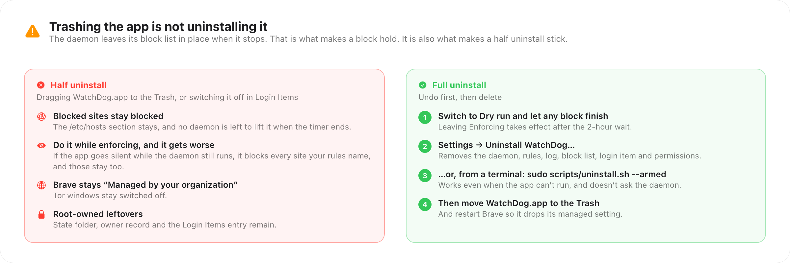

<p align="center">
  
</p>

<h1 align="center">WatchDog</h1>

<p align="center">
  <b>A focus enforcer for macOS that holds the line when you can't.</b><br>
  It sees what you're actually doing, lets focused work earn your breaks,<br>
  and when a rule says stop, a root daemon makes it stick.
</p>

<p align="center">
  <a href="https://watchdog.seturu.com"><b>watchdog.seturu.com</b></a>
</p>

<p align="center">
  
  
  
  
</p>

<p align="center">
  <picture>
    <source media="(prefers-color-scheme: dark)" srcset="docs/images/today-dark.png">
    
  </picture>
</p>

Most blockers give way the moment you want them to. A browser extension is two clicks from off. A timer is one ⌘Q from gone. WatchDog is split in two: a menu-bar app that watches and nudges, and a root daemon that keeps the rules and runs the blocks. Once you switch it to **Enforcing**, blocks can't be cancelled, relaxing a rule waits two hours, and the app won't quit.

> [!CAUTION]
> ### Never "half-uninstall" WatchDog
> **Dragging WatchDog.app to the Trash, or switching it off under System Settings → General → Login Items & Extensions, does not remove it.**
>
> When the daemon stops, it deliberately leaves its block list in `/etc/hosts` (otherwise stopping it would be an easy way to end a block). If you remove it half-way, whatever was blocked at that moment **stays blocked, with nothing left to unblock it**. Doing it while enforcing is worse: if the app stops reporting in while the daemon is still running, the daemon treats that as tampering and blocks **every site your rules name**, and those blocks stay too.
>
> **Always remove it properly:** switch to Dry run, wait for any block to finish, then use **Settings → Uninstall WatchDog…**, or run `sudo scripts/uninstall.sh --armed` from a terminal. Move the app to the Trash only after that. Already stuck? See [`docs/RESCUE.md`](docs/RESCUE.md) and [Uninstalling](#uninstalling).

---

## Why I built this

I have ADHD, and focusing is really hard for me, even on meds. I don't need to be told that YouTube is a distraction. I need something that remembers my plan when my attention doesn't. WatchDog lets you make the decision while you're thinking clearly, and keeps to it when you aren't.

I hope it helps anyone who needs it, neurodivergent or not.

## Honest about what it is

**WatchDog is not perfect, and it isn't a prison.** Someone with your administrator password and a terminal can remove it in about a minute. That is on purpose: a focus tool that could lock you out of your own Mac would be dangerous, so there's an uninstaller and a [printed rescue sheet](docs/RESCUE.md).

What it does is add **more friction and more incentive** than the usual options:

- **Friction.** The rules belong to a root process, not to you. While enforcing, blocks have no cancel button, loosening a rule or going back to dry run waits **2 hours**, the app can't be quit, and launchd brings it back if it's killed. Getting out means a deliberate, password-protected act, not a moment of weakness.
- **Incentive.** With the **"Pomodoro it"** rule, distractions aren't forbidden, they're *earned*: every hour of focus earns break time you can spend on YouTube, guilt-free. Your day is laid out in plain numbers, so you can see the focus you put in.

---

## What you get

### Rules you can read

Every rule is shown as one plain sentence, so you always know what you signed up for. Rules can match **sites** (subdomains included), **apps**, or **window titles**. They can apply all the time or on a schedule, and they can follow your pomodoro timer.

<p align="center">
  <picture>
    <source media="(prefers-color-scheme: dark)" srcset="docs/images/rules-dark.png">
    
  </picture>
</p>

| Count time… | Means |
|---|---|
| **In one sitting** | Fine for *N* minutes at a stretch. Short interruptions don't reset the count; longer breaks do. |
| **In total** | Fine for *N* minutes within the last 1, 2, 4 or 24 hours. |
| **Pomodoro it** | Only during breaks, and only while your earned break budget lasts. |
| **Not allowed at all** | A limit of zero. It fires as soon as the activity is seen. |

| Then… | What happens |
|---|---|
| **Warn me** | A notification. |
| **Close it** | Closes the matching tab (Brave, Chrome, Edge) and politely quits matching apps. Reopen it and it closes again within seconds. |
| **Block it** | A timed, system-wide block of 5 minutes to 4 hours, with no cancel button. |

### "Pomodoro it": earn your distractions

The classic 25 / 5 / 15 rhythm means each hour of focus earns **18 minutes** of break. Time on the activity during a break spends that budget. A single break tops out at the long-break length, and the budget starts at zero each day. All four numbers can be set per rule. Pausing the timer never loosens anything: a paused focus session still counts as focus.

### A pomodoro timer that rules can follow

A built-in timer with categories, a quick **Focused / Neutral / Distracted** rating and a note after each session, plus a history grouped by day. If you'd rather keep your existing timer, WatchDog can follow the Session app instead, read-only.

<p align="center">
  <picture>
    <source media="(prefers-color-scheme: dark)" srcset="docs/images/focus-dark.png">
    
  </picture>
</p>

### Always one click away

The menu-bar icon shows the number that matters right now: focus time left, or break budget left. Click it for the timer, the budget, today's totals and any running block.

<p align="center">
  <picture>
    <source media="(prefers-color-scheme: dark)" srcset="docs/images/popover-dark.png">
    
  </picture>
</p>

### Widgets on your desktop

**Focus & Breaks** (small, medium, large) shows today's focus, the breaks you've earned and the breaks you've taken. **Pomodoro** (small, medium) shows a live countdown with working buttons. Widgets only see totals and the timer's state, never window titles, addresses or apps.

<p align="center">
  <picture>
    <source media="(prefers-color-scheme: dark)" srcset="docs/images/widgets-dark.png">
    
  </picture>
</p>

### Setup without a terminal

A checklist of everything WatchDog needs from macOS, each step with the one button that moves it forward.

<p align="center">
  <picture>
    <source media="(prefers-color-scheme: dark)" srcset="docs/images/setup-dark.png">
    
  </picture>
</p>

---

## How it works

<p align="center">
  <picture>
    <source media="(prefers-color-scheme: dark)" srcset="docs/images/arch-dark.png">
    
  </picture>
</p>

### Two processes, split by trust

| | **WatchDog.app** (you) | **WatchDogDaemon** (root) |
|---|---|---|
| Runs as | Your user, menu-bar app plus a login agent | root, a launchd daemon embedded in the app bundle |
| Knows | What you're doing, minute by minute | Only what the app reports, plus the rules |
| Owns | Usage history, the pomodoro timer | Rules, the Enforcing switch, blocks, the audit log |
| Can be stopped by you | Not while enforcing (quit is refused, launchd restarts it) | Only with an administrator password |

A root daemon can't see your windows or close a tab, and your app can't be trusted to keep a promise. So the app observes and decides, and the daemon enforces and remembers. The app is the less trusted half, which is why the daemon also watches *it*.

### 1. Tracking

Every **2 seconds**, plus on every app switch, the app records the front app, the window title (via Accessibility), the current tab's address in Brave, Chrome, Edge, Arc or Safari (via Automation), what's making sound, and whether you've been away (**2 minutes** without input). Samples merge into time spans in a local SQLite database. No Screen Recording permission is needed.

### 2. Rules

About every **4 seconds** the rule engine checks your spans against each rule's targets, schedule, timer condition and limit. Firings are logged to History, and each rule then stays quiet for its cooldown. Everything starts in **Dry run**: rules only notify, so you can tune thresholds for a few days before anything bites.

### 3. Enforcement, in escalating steps

- **Warn**: a notification.
- **Close**: the app closes matching tabs by tab ID through AppleScript and asks matching apps to quit, so you still get the save dialog.
- **Block**: the app asks the daemon to start a timed block. From then on the daemon is in charge.

### 4. The daemon's rules about rules

The daemon owns `config.json`. The app edits a draft and *proposes* it:

- In dry run, changes apply at once.
- While enforcing, a change that only **tightens** applies at once. Anything that **loosens** (including any edit to an active rule, and switching back to dry run) waits a **2-hour cooling-off period**, and is **refused while a block runs**. A pending change can be discarded. Asking again doesn't restart the wait.
- Rule sets with duplicate IDs are refused, and refused input is escaped before it's logged.

### 5. Blocking layers

Every 2 seconds the daemon makes the system match the active block:

- **`/etc/hosts`**: blocked domains point to `0.0.0.0`, inside WatchDog's own marked section only. Every line outside it is preserved exactly, and the file is written atomically. Edits inside the section are reverted.
- **Firewall (optional, off by default)**: a private `pf` anchor that blocks outbound traffic to the blocked sites' addresses and kills connections that are already open. It never edits `/etc/pf.conf`, and it stands down if other software is using the firewall.
- **Browser policy**: while enforcing, Brave's Tor windows are disabled from its next launch, since they'd bypass the hosts file.

### 6. Time you can't fake

A block counts down on `CLOCK_MONOTONIC_RAW`, which keeps running through sleep and ignores the system date. It's checkpointed every 10 seconds and resumes after a restart, so a restart can make a block a few seconds longer, never shorter. Schedules ("weekdays 9 to 7") use a trusted clock pinned at boot. If the system clock or time zone jumps, schedules carry on in the original time and the app tells you.

### 7. Watching the watcher

Every ~8 seconds the app sends a heartbeat saying whether it can still see (Accessibility and browser access) and when it last checked the rules. While enforcing, if the heartbeats stop, the app reports it's blind, or it stops checking rules, the daemon **blocks every site your enabled rules name** until the app is healthy again. Quitting the app or revoking its permissions doesn't free you; it does the opposite.

### 8. Who can talk to the daemon

The XPC listener only accepts a client signed by the same team, with the expected bundle identifier, running as the **enrolled owner** in the active console session. The armed app is installed **root-owned** in `/Applications`, and won't register its daemon from a copy any user process could modify.

### 9. Guard rails

- **Never blocked**, whatever a rule says: `apple.com`, `icloud.com`, `cdn-apple.com`, `mzstatic.com`, `anthropic.com`, `claude.ai`.
- **No block longer than 4 hours.**
- An **audit log** of every attempt to loosen things: `/Library/Application Support/WatchDog/audit.log` (readable with `sudo`).

### Your data stays yours

- **No account, no cloud, no telemetry.** Nothing is sent anywhere. The only network traffic WatchDog causes is the DNS lookups the optional firewall needs to find blocked sites' addresses.
- History lives in a private App Group container readable only by your account (`0600`), with SQLite secure delete on.
- By default only the **site** is stored, not the full page address. You can opt into full addresses with tokens, keys, emails and similar parts removed, or keep them as they are.
- Window titles, addresses and track names are cleared after **30 days**, and activity is deleted after **a year**. Both can be changed in Settings.
- The daemon's state folder is root-only (`0700`).

---

## What it can't stop

Being clear about the limits is part of the design.

| Way out | Effort | What WatchDog does about it |
|---|---|---|
| Run the uninstaller | ~1 min, password and a terminal | Nothing, by design. It's the rescue path. |
| Switch the daemon off in Login Items | A few clicks | Running blocks **freeze** in place rather than ending. No new blocks start. |
| Edit `/etc/hosts` | Seconds | Reverted within 2 seconds. |
| Use another browser | Trivial | The hosts block is system-wide. |
| Quit the app, revoke its permissions | Seconds | Quitting is refused and a killed app comes straight back. Going blind blocks everything your rules name. |
| Change the clock | 30 s | Blocks ignore it; schedules keep the original time. |
| VPN, proxy, a phone | Varies | Out of scope. |

In short, a determined you can get out with a password and a terminal. The easy, impulsive routes are closed.

---

## Install

There's no download yet, so WatchDog is built from source on your own Mac. A free Apple ID is enough; no paid developer account is needed.

**Requirements:** macOS 26 Tahoe · Xcode with the macOS 26 SDK, opened once · your Apple ID added in Xcode → Settings → Apple Accounts · [XcodeGen](https://github.com/yonaskolb/XcodeGen) (the build script offers to install it with Homebrew).

### Quick start

```bash
git clone https://github.com/seturu/WatchDog.git
```

```bash
cd WatchDog
```

```bash
scripts/build.sh
```

The script checks Xcode and XcodeGen, finds your team ID (from your Apple Development certificate or the accounts in Xcode) and saves it in `Config/Local.xcconfig`, generates the Xcode project, and builds the development build. It prints the path of the app and how to start it; it doesn't install or start anything itself.

The team ID matters because the app and the daemon only trust code signed by the same team. `Config/Local.xcconfig` is ignored by git, and both Xcode and the installer read it. To set it by hand instead, copy [`Config/Local.example.xcconfig`](Config/Local.example.xcconfig) to `Config/Local.xcconfig` and fill in `DEVELOPMENT_TEAM`.

### Step 1: try the development build (safe)

The Debug build has its own identity (`local.watchdog.dev`) and hard safety caps: blocks of **5 minutes at most**, only `example.com` / `.org` / `.net` can be blocked, loosening waits 2 minutes, and the daemon resets itself every 15 minutes.

`scripts/build.sh` builds it. Start the app it prints, then open **Setup** in the sidebar and work down the list.

Prefer Xcode? Run `xcodegen generate`, open `WatchDog.xcodeproj`, and build and run the **WatchDog** scheme.

### Step 2: the armed build

The Release build is the real thing: 4-hour blocks, any site except the never-block list, a 2-hour cooling-off period, and no self-reset. **Print [`docs/RESCUE.md`](docs/RESCUE.md) first.**

```bash
scripts/build.sh --armed
```

```bash
sudo scripts/install-armed.sh
```

The installer puts a root-owned copy in `/Applications`, verifies the signatures, and enrolls the account that ran `sudo` as the owner. Installing doesn't start enforcing: open WatchDog, go through **Setup**, add rules, watch them in dry run, and switch the toolbar to **Enforcing** when you're ready.

> [!NOTE]
> Free Personal Team certificates last a year. After renewing, expect to approve the background service and Accessibility once more.

---

## Uninstalling

<p align="center">
  <picture>
    <source media="(prefers-color-scheme: dark)" srcset="docs/images/uninstall-dark.png">
    
  </picture>
</p>

**From the app** (dry run, no block running): **Settings → Uninstall WatchDog…** removes the daemon, its rules and log, any block list it wrote, the login agent and WatchDog's privacy permissions. You choose whether to keep your usage history. Then move the app to the Trash.

**From a terminal** (works even if the app can't run, and doesn't ask the daemon's permission):

```bash
sudo scripts/uninstall.sh --armed
```

Use it without `--armed` for the development build. It stops the daemon first (so nothing gets put back), strips WatchDog's section from `/etc/hosts`, removes only the browser policies WatchDog wrote, empties its firewall anchor, deletes the root-owned state and owner record, and resets privacy permissions. Afterwards, delete the app and restart Brave.

**Locked out, or the project folder is gone?** [`docs/RESCUE.md`](docs/RESCUE.md) has every step by hand, including Safe Mode, which never loads WatchDog.

---

## Project layout

| Path | What's there |
|---|---|
| [`App/`](App) | The menu-bar app: tracking, rule runner, enforcement, pomodoro timer, SwiftUI screens |
| [`Daemon/`](Daemon) | The root daemon: blocks, hosts, firewall and policy layers, owner enrollment |
| [`Widgets/`](Widgets) | The WidgetKit extension (sandboxed, reads a numbers-only snapshot) |
| [`Packages/WatchDogCore/`](Packages/WatchDogCore) | Shared logic with no side effects, all unit-tested: rule engine, config policy, trusted clock, pomodoro machine, hosts parsing, storage |
| [`scripts/`](scripts) | Build, install and uninstall |
| [`docs/RESCUE.md`](docs/RESCUE.md) | The rescue sheet. Print it. |
| [`PLAN.md`](PLAN.md) | Design notes, decisions, milestones and what has been verified |

## Development

```bash
swift test --package-path Packages/WatchDogCore
```

The project file is generated: edit [`project.yml`](project.yml), not Xcode's build settings. The development build also has a few command-line helpers, such as `--rules` (prints each rule's current count and whether it would fire) and `--show-window`.

The screenshots in this README are faithful mockups of the SwiftUI layouts with sample data, so no real history ends up in the repo. When a screen changes, update its frame in [`docs/images/source/mockups.html`](docs/images/source/mockups.html) and run:

```bash
docs/images/source/render.sh
```

## Status

WatchDog is young: one person built it for their own Mac. The core logic is covered by 191 unit tests and the main enforcement paths have been run live in the development build, but some paths still need a run on a fresh test Mac, among them a reboot in the middle of a block and the armed install end to end. See [`PLAN.md`](PLAN.md) for exactly what has and hasn't been verified.

## License

WatchDog is free software. You can use it, study it, share it and change it under the [GNU General Public License v3.0 or later](LICENSE). If you share a changed version, share its source under the same license. Using it on your own Mac, at home or at work, needs nothing from you.

Bundled components keep their own licenses: GRDB (MIT) and SQLCipher (BSD-style). See [`THIRD-PARTY-NOTICES.md`](THIRD-PARTY-NOTICES.md).

WatchDog is free and stays free. A company that wants to build it into a closed-source product can ask for a separate commercial license through the contact on my GitHub profile. Want to help? See [`CONTRIBUTING.md`](CONTRIBUTING.md).

Copyright © 2026 Luis Alonso.

---

<p align="center">
  Built by someone with ADHD, for anyone who needs a little help holding the line.<br>
  If it gets you one more good hour, it did its job.
</p>

<p align="center">
  <sub>
    Thank you to the people whose work WatchDog is built on:
    <a href="https://github.com/groue/GRDB.swift">GRDB.swift</a> by <a href="https://github.com/groue">Gwendal Roué</a>,
    <a href="https://www.zetetic.net/sqlcipher/">SQLCipher</a> by <a href="https://www.zetetic.net/">Zetetic</a>,
    <a href="https://sqlite.org/">SQLite</a> by D. Richard Hipp and the SQLite developers,
    and <a href="https://github.com/yonaskolb/XcodeGen">XcodeGen</a> by <a href="https://github.com/yonaskolb">Yonas Kolb</a>.
    Their licenses are in <a href="THIRD-PARTY-NOTICES.md">THIRD-PARTY-NOTICES.md</a>.
  </sub>
</p>

<p align="center">
  <sub>A project by <a href="https://seturu.com">seturu.com</a></sub>
</p>
